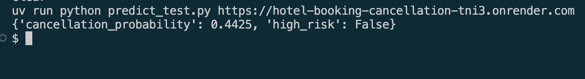

# Hotel booking cancellation

A web service that estimates the probability that a hotel booking will be cancelled, using only what is known when the booking is created.

## Problem

Around 37% of the bookings in this dataset were cancelled. A cancellation close to arrival leaves a room empty that could have been sold, and hotels respond with broad overbooking or strict deposit rules that also affect reliable guests.

This project scores each booking as it is created. The reservation system sends the booking to the service and receives a probability and a `high_risk` flag.

Staff can use the flag to:

- ask for a prepayment or a card guarantee on high-risk bookings only,
- contact those guests to confirm the stay,
- estimate how many rooms are likely to be released for a given date.

The model supports these decisions and does not replace them. A flagged booking should lead to a follow-up, not an automatic rejection.

## Data

The project uses the [Hotel Booking Demand](https://www.sciencedirect.com/science/article/pii/S2352340918315191) dataset (Antonio, Almeida and Nunes, *Data in Brief*, 2019). It has 119,390 bookings for one city hotel and one resort hotel in Portugal, with arrivals from July 2015 to August 2017.

The file is included as `data/hotel_bookings.csv`. It can also be downloaded with:

```bash
curl -L -o data/hotel_bookings.csv https://raw.githubusercontent.com/rfordatascience/tidytuesday/master/data/2020/2020-02-11/hotels.csv
```

## Approach

The full analysis is in `notebook.ipynb`.

**Leakage.** Several columns are, or may be, filled in or changed after the booking is created, so they are excluded: `reservation_status`, `reservation_status_date`, `assigned_room_type`, `booking_changes`, `required_car_parking_spaces`, `total_of_special_requests` and `country`. Adding five of them back would raise validation AUC from 0.823 to 0.899, but the service could not reproduce that score on new bookings.

**Split.** The model is trained on past arrivals and evaluated on later ones.

| Part | Arrivals | Rows |
|---|---|---|
| train | before October 2016 | 64,113 |
| validation | October 2016 to March 2017 | 27,265 |
| test | from April 2017 | 27,830 |

**Models.** Each model was tuned on the validation part.

| Model | Validation ROC AUC |
|---|---|
| XGBoost | 0.8234 |
| Random forest | 0.8217 |
| Decision tree | 0.8131 |
| Logistic regression | 0.8016 |

**Final model.** XGBoost trained on train and validation together.

| Test metric | Value |
|---|---|
| ROC AUC | 0.8053 |
| ROC AUC, `No Deposit` bookings only | 0.7424 |
| ROC AUC, duplicates removed | 0.7532 |
| Precision at threshold 0.45 | 0.681 |
| Recall at threshold 0.45 | 0.650 |

The threshold was chosen on the validation part to reach a precision of 0.75. On the later test period precision is lower at 0.681, and the service flags 39% of bookings rather than 20%. The threshold should be checked against recent bookings before real use.

## Project structure

| File | Purpose |
|---|---|
| `notebook.ipynb` | Data cleaning, EDA, feature importance, model selection and tuning |
| `train.py` | Trains the final model and saves it to `model.bin` |
| `predict.py` | FastAPI service that serves the model |
| `predict_test.py` | Sends a sample booking to the service |
| `Dockerfile` | Container image for the service |
| `render.yaml` | Cloud deployment configuration for Render |
| `pyproject.toml`, `uv.lock` | Dependencies |

## Tools

| Tool | What it does here |
|---|---|
| [uv](https://docs.astral.sh/uv/) | Creates the virtual environment and installs the exact package versions from `uv.lock`. It replaces `pip` and Pipenv |
| [scikit-learn](https://scikit-learn.org/) | Provides `DictVectorizer`, which one-hot encodes the features, plus the logistic regression, decision tree and random forest models |
| [XGBoost](https://xgboost.readthedocs.io/) | Gradient boosted trees, used for the final model |
| [FastAPI](https://fastapi.tiangolo.com/) | Serves the model over HTTP and validates incoming requests. It fills the same role as Flask |
| [Uvicorn](https://www.uvicorn.org/) | The web server that runs the FastAPI app |
| [Docker](https://www.docker.com/) | Packages the service with its dependencies |
| [Render](https://render.com) | Cloud platform that builds and runs the Docker image |

The Docker image skips `nvidia-nccl-cu12`, a GPU communication library that XGBoost installs on Linux. The service runs on CPU and does not need it.

## Setup

The project uses Python 3.11.

Install the dependencies into a virtual environment:

```bash
uv sync
```

Activate the environment:

```bash
source .venv/bin/activate
```

On macOS, XGBoost also requires OpenMP:

```bash
brew install libomp
```

## Train the model

```bash
uv run python train.py
```

## Run the notebook

```bash
uv run jupyter notebook notebook.ipynb
```

## Run the service locally

```bash
uv run uvicorn predict:app --host 0.0.0.0 --port 9696
```

In another terminal:

```bash
uv run python predict_test.py
```

The response looks like this:

```json
{"cancellation_probability": 0.4425, "high_risk": false}
```

Interactive API documentation is available at <http://localhost:9696/docs>.

## Run with Docker

```bash
docker build -t hotel-booking-cancellation .
docker run -it --rm -p 9696:9696 hotel-booking-cancellation
```

Then, in another terminal:

```bash
uv run python predict_test.py
```

## Deploy to the cloud

The service can be deployed on [Render](https://render.com) with the included `render.yaml`:

1. Push this repository to GitHub.
2. In Render, select **New**, then **Blueprint**, and connect the repository.
3. Apply the blueprint and wait for the build to finish.
4. Test the deployed service with its URL:

```bash
uv run python predict_test.py https://your-service.onrender.com
```

On the free plan the service sleeps when idle, so the first request can take up to a minute.

### Deployed service

The service is available at <https://hotel-booking-cancellation-tni3.onrender.com/docs>, where requests can be tried in the browser.

